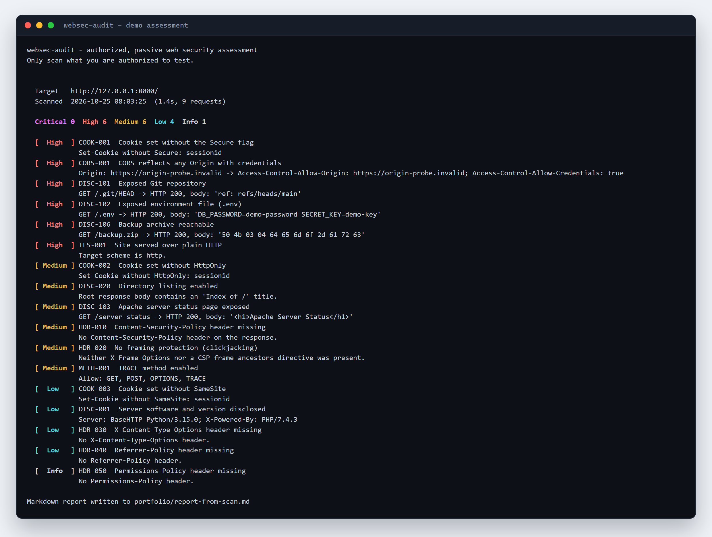
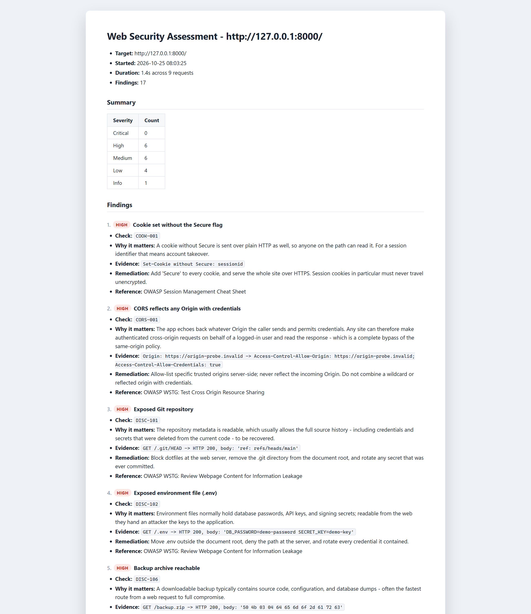
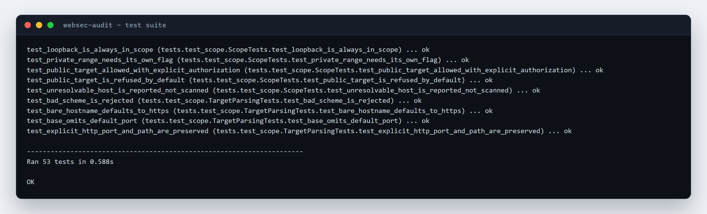

# websec-audit — portfolio writeup

A Python tool that audits a web application's security configuration and produces a severity-ranked
report a developer can act on. Built to practice the part of testing that actually gets read: the
writeup.

---

## CARL

### Context

Every web app ships with a default configuration, and the default is almost always the unsafe one:
no security headers, session cookies without flags, `.git` still sitting in the document root, TRACE
enabled because nobody turned it off. Before this project I could find those things by clicking
around in Burp one at a time, but I had nothing that produced a repeatable result — and nothing that
looked like the deliverable a tester hands over at the end of an engagement.

I also wanted to write real security tooling in Python rather than only using other people's tools.
Reaching for a scanner is easy; understanding why a check matters enough to encode it is the skill
I wanted to build.

### Action

I built a dependency-free scanner in Python — `urllib`, `ssl`, and `socket` only — organised around
seven check families: response headers, cookies, TLS, information disclosure, HTTP methods, CORS,
and HTTPS redirects.

The part I am most deliberate about is **scope**. The tool refuses to touch anything that is not
loopback unless the operator passes `--allow-private` for lab ranges or `--authorize` for a public
target, and the check runs before the first request is built. Hostnames are resolved and every
returned address must be in scope, so pointing a friendly name at a public IP does not get around
it. Writing that guard first, rather than bolting it on afterward, is the difference between a tool
I can publish and one I shouldn't.

Each finding carries what was observed, why it matters, the evidence, and the remediation. The
evidence quotes the actual matched content — the `ref: refs/heads/main` line from `.git/HEAD`, the
exact `Access-Control-Allow-Origin` value reflected back — because a finding someone else cannot
reproduce is just an opinion.

I tested it at two levels: 53 unit tests over the checks and the scope guard, plus an end-to-end test
that starts a deliberately misconfigured server on a loopback port and scans it over a real socket.
That integration test caught two real bugs — a severity lookup that crashed the exit code, and
evidence lines that said "matching content" instead of showing what matched.

### Result

A working tool with a CI-friendly exit code, Markdown and JSON output, and a sample report generated
from a live scan. The report reads like something from a junior penetration test: a severity table,
then findings ordered High → Info, each with evidence and a fix.

Concretely: `python -m websec_audit http://127.0.0.1:8000 --markdown report.md` produces a
17-finding report against the demo server in about 1.4 seconds across 9 requests, and exits 1
because it found High-severity issues — which is what makes it usable as a staging gate.

### Learned

Three things I did not expect.

**Scope is a design constraint, not a disclaimer.** Once I decided the tool could be published, the
authorization guard had to be the first thing that runs and the hardest thing to bypass. Treating it
as a feature rather than a warning label changed the architecture.

**Evidence quality is the product.** My first version reported "exposed Git repository" and moved on.
Reading it back, I would not have believed me. Quoting the matched bytes makes the finding
self-verifying and takes the same amount of code.

**Tests found the boring bugs, not the interesting ones.** Both defects were plumbing — a lookup and
a string. That is the argument for writing a real end-to-end test instead of trusting unit tests
that only exercise the happy path.

---

## Artifacts

All three are rendered from real output; see [`portfolio/README.md`](../portfolio/README.md) for how
they were captured and how to regenerate them.

---

## Resume bullets

Pick two or three, not all four:

- Built a dependency-free Python web security assessment tool covering response headers, cookie
  attributes, TLS configuration, information disclosure, HTTP methods, and CORS, with severity-ranked
  Markdown and JSON reporting.
- Designed an authorization guard that resolves the target and refuses out-of-scope hosts before any
  request is sent, requiring explicit flags for private ranges and public targets.
- Wrote 53 unit tests plus an end-to-end test that scans a deliberately misconfigured local server
  over a real socket; the integration test caught two defects that unit tests alone missed.
- Generated a 17-finding sample report against a live demo server, with quoted evidence and
  remediation guidance for every finding.

## For the interview

If asked "walk me through a decision", use the scope guard: the interesting part is that hostname
resolution has to happen before the request, and that every resolved address must be checked, or the
guard is theatre.

If asked "what would you build next", the honest answer is authenticated scanning and a second
request path that repeats checks across a crawl — the current version tests one URL, which is the
biggest limitation.

If asked "what did you get wrong", the evidence wording is the best answer: the first version said
"matching content", which proves nothing, and the fix was to quote the bytes.
